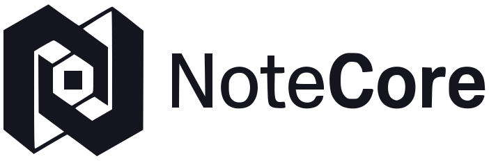

<p align="center">
  <picture>
    <source media="(prefers-color-scheme: dark)" srcset="docs/assets/logo-dark.svg">
    
  </picture>
</p>

# NoteCore

[](https://github.com/NICE-DEV226/NoteCore/actions/workflows/ci.yml)

Prise de notes Markdown **locale et hors ligne**, pour étudiants et développeurs.

Notes, dossiers, tags, recherche plein texte, mise en forme complète avec aperçu, pièces jointes locales, exports Markdown et sauvegardes vérifiables. Pas de compte, pas de serveur, pas de synchronisation : la base SQLite locale est l'unique source de vérité.

## Sommaire

- [Fonctionnalités](#fonctionnalités)
- [Architecture](#architecture)
- [Installer](#installer)
- [Prérequis](#prérequis)
- [Construire l'application](#construire-lapplication)
- [Développement](#développement)
- [Tests et intégration continue](#tests-et-intégration-continue)
- [Vos données](#vos-données)
- [Documentation](#documentation)
- [Licence](#licence)

## Fonctionnalités

**Organisation**

- Notes en Markdown, dossiers, tags colorés, épinglage.
- Recherche plein texte (SQLite FTS5) avec extraits où les termes trouvés sont surlignés.
- Enregistrement automatique après une courte pause, indicateur d'état (`enregistré`, `modifié`, `en cours`, `erreur`), plus `Ctrl/Cmd+S`.

**Écriture**

- Éditeur Markdown et aperçu côte à côte.
- Barre de mise en forme : titres, gras, italique, mise en évidence, code en ligne et en bloc, listes — à puces, ordonnée, cases à cocher —, citations, liens, images, séparateur, effacement de la mise en forme.
- Raccourcis `Ctrl/Cmd+B` (gras) et `Ctrl/Cmd+I` (italique) dans l'éditeur.
- Pièces jointes locales : une image ou un fichier se joint à une note, 10 Mio au maximum par pièce jointe. Elles se **lisent dans NoteCore** (images, PDF, texte et code, Markdown, tableaux CSV, contenu d'une archive .zip, audio, vidéo) et se parcourent toutes depuis la vue **Fichiers**.

**Révision**

- Cartes écrites **dans la note** : `{{c1::mot caché}}`, `{{c1::mot::indice}}` ou une ligne `Question :: Réponse`. Pas de seconde copie à synchroniser.
- Séance au clavier (`Espace`, `1`–`4`, `Z` pour annuler), planifiée par l'algorithme **FSRS**, entièrement local.
- Accueil : cartes à voir, série de jours, activité sur 14 jours, maîtrise par dossier et par étiquette.

**Partage hors connexion**

- **Partager** une note, un dossier ou tout : en **fichier** `.notecore` (clé USB, Bluetooth, dossier partagé…) ou en **envoi direct sur le réseau local** (lien et QR code, un seul téléchargement, 10 minutes), sans Internet. Mot de passe facultatif (AES-256).
- **Importer** un paquet NoteCore, une archive d'export ou des fichiers Markdown d'autres outils. Importer **n'écrase jamais** une note existante.

**Confort**

- Thème clair ou sombre, aligné sur le système par défaut.
- Personnalisation : 22 polices embarquées (interface, texte, titres, code), taille, interligne, graisse, largeur, couleur d'accent, densité, préréglages. Ces réglages sont **locaux et sans effet sur la note** — le Markdown reste portable.
- Palette de commandes (`Ctrl/Cmd+K`), modes Éditer / Scinder / Aperçu, mode concentration (`Ctrl/Cmd+\`), paramètres (`Ctrl/Cmd+,`).
- Accessibilité : navigation clavier, focus piégé dans les boîtes de confirmation, annonces `aria-live`, contrastes texte/fond tenus au-dessus de 4,5:1.

## Architecture

Application de bureau mono-utilisateur, conçue comme un **monolithe modulaire** : un seul processus, avec une frontière nette entre l'interface, les cas d'usage et la persistance. Aucun serveur distant, aucun compte, aucune synchronisation réseau.

```text
frontend/          Svelte 5 + TypeScript + Vite
                   Affichage, état de navigation et interactions.
                   Ne connaît ni SQL ni chemins système.

backend/           Go + Wails v2
  main.go          Fenêtre, embarquement du bundle, ouverture de la base
  internal/notes       Notes, dossiers, tags, pièces jointes
  internal/storage     Schéma et migrations SQLite
  internal/search      Recherche FTS5 et construction des extraits
  internal/transfer    Export, sauvegarde, validation, restauration
  internal/review      Cartes de révision, planification FSRS, maîtrise
  internal/share       Partage hors connexion, import, envoi sur le réseau local
  internal/preferences Préférences locales
  internal/bindings    Méthodes exposées à Wails

packaging/         Éléments d'installation du bureau
docs/              Architecture et décisions techniques (ADR)
```

SQLite est l'unique source de vérité ; le frontend n'appelle que les méthodes Wails exposées par le backend. Le contenu des notes n'est jamais transformé en format propriétaire : c'est du Markdown, ce qui garantit qu'un export reste lisible sans NoteCore.

## Installer

Les fichiers ci-dessous sont publiés sur la page des [releases](https://github.com/NICE-DEV226/NoteCore/releases), avec un fichier `SHA256SUMS` :

```bash
sha256sum -c SHA256SUMS --ignore-missing   # Linux ; sous Windows : Get-FileHash <fichier>
```

Installer, mettre à jour ou désinstaller NoteCore **ne touche jamais à vos notes** : elles vivent dans un dossier à part (voir « Vos données »).

### Windows 10 / 11

| Fichier | Usage |
| --- | --- |
| `notecore-<version>-windows-x64-setup.exe` | **Recommandé.** Installateur sans droits administrateur : installe pour l'utilisateur dans `%LOCALAPPDATA%\Programs\NoteCore`, crée les raccourcis (menu Démarrer, bureau) et un désinstallateur (Paramètres → Applications). |
| `notecore-<version>-windows-x64.exe` | Exécutable autonome, sans installation (clé USB, poste verrouillé). |

NoteCore s'affiche avec le runtime **WebView2** (déjà présent sous Windows 11 et sur la plupart des Windows 10 à jour). L'installateur le détecte et ne le télécharge que s'il manque ; l'exécutable autonome le fait à son premier lancement. Dans ce seul cas, une connexion est nécessaire — une fois.

> Les exécutables ne sont pas signés numériquement : Windows SmartScreen peut afficher « Windows a protégé votre ordinateur ». Cliquez sur **Informations complémentaires**, puis **Exécuter quand même**, après avoir vérifié l'empreinte.

### Linux

| Distribution | Commande |
| --- | --- |
| Arch, Manjaro | `git clone https://github.com/NICE-DEV226/NoteCore && cd NoteCore/packaging/aur && makepkg -si` (compile depuis la version publiée), ou l'archive ci-dessous |
| Debian, Ubuntu et dérivés (22.04+) | `sudo apt install ./notecore-<version>-linux-amd64.deb` |
| Toutes les autres | `tar xzf notecore-<version>-linux-x64.tar.gz && cd notecore-<version>-linux-x64 && ./install.sh` |

`install.sh` installe **pour l'utilisateur courant**, sans `sudo`, dans `~/.local` ; `./install.sh --system` installe pour tous (`/usr/local`) et `./install.sh --uninstall` désinstalle. Il vérifie d'abord la présence de **WebKitGTK 4.1** et de **GTK 3** et, s'ils manquent, affiche la commande exacte pour votre distribution (pacman, apt, dnf, zypper).

Désinstaller : `sudo apt remove notecore` (deb), `sudo pacman -R notecore` (Arch, paquet construit avec `makepkg`), `./install.sh --uninstall` (archive).

### À partir des sources

Voir [docs/procedure-build.md](docs/procedure-build.md).

Au premier lancement, un **guide de prise en main** présente l'essentiel et peut créer une note d'exemple ; il se rouvre depuis Paramètres → Aide.

## Prérequis

| Outil          | Version                                                         |
| -------------- | --------------------------------------------------------------- |
| Go             | 1.27 ou plus récent (aligné sur `backend/go.mod`)               |
| Node.js et npm | Node 20 ou plus récent                                          |
| CLI Wails      | v2 — `go install github.com/wailsapp/wails/v2/cmd/wails@latest` |
| Linux          | `gcc`, `pkg-config`, GTK 3, WebKitGTK 4.1                       |

Installation des dépendances système :

```bash
# Arch
pacman -S gcc pkgconf gtk3 webkit2gtk-4.1 npm

# Debian / Ubuntu
apt install gcc pkg-config libgtk-3-dev libwebkit2gtk-4.1-dev npm
```

## Construire l'application

Une seule commande compile le frontend, l'incorpore au binaire et compile l'application :

```bash
cd backend
$(go env GOPATH)/bin/wails build
```

Le binaire est produit dans `backend/build/bin/notecore` :

```bash
./build/bin/notecore
```

> **Linux — WebKitGTK 4.0 contre 4.1.** Wails v2 interroge `pkg-config` sous le nom `webkit2gtk-4.0`, que les distributions récentes ne fournissent plus. Créez un alias local le temps de la compilation :
>
> ```bash
> pkgdir=$(mktemp -d)
> cp /usr/lib/pkgconfig/webkit2gtk-4.1.pc "$pkgdir/webkit2gtk-4.0.pc"
> PKG_CONFIG_PATH=$pkgdir wails build
> ```
>
> Le fichier est **copié, jamais réécrit** : son champ `Libs` doit continuer de pointer vers `-lwebkit2gtk-4.1`, seule bibliothèque réellement installée. Substituer le nom casserait l'édition de liens.

> **Ne lancez pas `wails build -s`.** `-s` saute la compilation du frontend, alors que le bundle est intégré au binaire Go par `go:embed` : un bundle périmé serait embarqué sans avertissement.

### Windows 10 / 11

La cible Windows n'utilise pas de cgo : elle se compile **depuis Linux**, sans chaîne de compilation croisée.

```bash
cd backend
CGO_ENABLED=0 $(go env GOPATH)/bin/wails build -platform windows/amd64
```

Le résultat, `backend/build/bin/notecore.exe`, est **autonome** : environ 15 Mo, interface embarquée, rien à installer à côté. Sur Windows, il suffit de double-cliquer.

> Windows a besoin du runtime **Microsoft Edge WebView2**, fourni d'origine avec Windows 11 et présent sur les Windows 10 à jour. S'il manque, l'application propose son installation au premier lancement.

L'intégration continue produit cet exécutable à chaque push sur `main` : onglet **Actions**, workflow **Windows**, artefact `notecore-windows-x64`. Une étiquette `v*` crée en plus un release GitHub avec le fichier attaché.

## Développement

Le frontend tourne seul, sur une API simulée — pratique pour travailler l'interface sans backend natif :

```bash
cd frontend
npm install
npm run dev        # http://localhost:5173
```

Le backend se teste indépendamment :

```bash
cd backend
go test ./...
```

Pour l'application complète avec rechargement, voir `docs/procedure-build.md`.

## Tests et intégration continue

| Commande                       | Portée                                                                   |
| ------------------------------ | ------------------------------------------------------------------------ |
| `cd backend && gofmt -l .`     | formatage Go                                                             |
| `cd backend && go vet ./...`   | analyse statique Go                                                      |
| `cd backend && go test ./...`  | migrations, persistance, recherche, pièces jointes, export et sauvegarde |
| `cd frontend && npm run check` | types et composants Svelte (`svelte-check`)                              |

L'intégration continue rejoue ces contrôles, puis compile l'application complète avec Wails, à chaque push et pull request sur `main`. Voir `.github/workflows/ci.yml`.

Un second workflow, `.github/workflows/windows.yml`, construit l'exécutable Windows : il le publie en artefact à chaque push, et l'attache à un release GitHub lorsqu'une étiquette `v*` est poussée.

## Vos données

Base locale SQLite, en mode WAL :

| Système | Emplacement                                          |
| ------- | ---------------------------------------------------- |
| Linux   | `~/.config/NoteCore/notecore.db`                     |
| macOS   | `~/Library/Application Support/NoteCore/notecore.db` |
| Windows | `%APPDATA%\NoteCore\notecore.db`                     |

**Export.** Une note part en fichier Markdown UTF-8 ; ses pièces jointes sont écrites dans un dossier frère `<titre>-assets/` et les références sont réécrites en chemins relatifs, de sorte que le document reste lisible sans NoteCore. Plusieurs notes produisent une archive versionnée accompagnée d'un manifeste JSON.

**Sauvegarde et restauration.** Une sauvegarde est une copie cohérente de la base (checkpoint SQLite préalable), accompagnée de métadonnées de format et de la version de schéma. Une restauration est relue dans une zone temporaire, validée, présentée en aperçu des conflits, puis appliquée par remplacement atomique ou import explicite — jamais en écrasant silencieusement des données.

**Mise à niveau.** Installer une version plus récente conserve vos notes : la base vit hors du dossier d'installation, donc remplacer le binaire ne touche à rien. Si la nouvelle version doit migrer le schéma de la base, une copie de celle-ci est écrite à côté — avant la moindre écriture — et son chemin est affiché au lancement. Rien n'est perdu, même si une migration venait à échouer.

**Réseau.** L'application ne se connecte jamais à Internet : ni compte, ni télémétrie, ni synchronisation. Le seul trafic réseau est le **partage sur le réseau local**, que vous lancez vous-même : un serveur éphémère (un fichier, un téléchargement, 10 minutes, jeton aléatoire) ou la réception d'un envoi, limitée aux adresses de votre réseau local. Sous Windows, le pare-feu peut demander l'autorisation la première fois (réseaux privés).

**Pièces jointes.** Les octets vivent dans la base (table `attachments`), donc sauvegardés et restaurés avec le reste, et supprimés avec leur note. Aucune copie externe, aucun service tiers.

**Cartes de révision.** Le texte d'une carte reste dans la note ; la base ne conserve que l'état d'apprentissage (tables `cards` et `review_log`), sauvegardé et restauré avec le reste. Supprimer une note supprime ses cartes. La planification est calculée localement.

## Documentation

- [`docs/architecture/ARCHITECTURE.md`](docs/architecture/ARCHITECTURE.md) — architecture, modèle de données, sauvegardes, sécurité
- [`docs/architecture/ADR-001`](docs/architecture/ADR-001-stack-et-style.md) à [`ADR-007`](docs/architecture/ADR-007-revision-espacee.md) — décisions techniques et raisons
- [`ADR-008`](docs/architecture/ADR-008-partage-hors-connexion.md) — partage hors connexion, import et lecture des fichiers joints
- [`docs/cahier-des-charges-v2.md`](docs/cahier-des-charges-v2.md) — V2 : réviser ses notes (périmètre, critères, risques)
- [`docs/revue-ergonomie.md`](docs/revue-ergonomie.md) — revue d'ergonomie et correctifs appliqués
- [`docs/procedure-build.md`](docs/procedure-build.md) — build et développement en détail
- [`docs/release-notes/`](docs/release-notes) — notes de version

## Licence

Apache 2.0 — voir [`LICENSE`](LICENSE).
