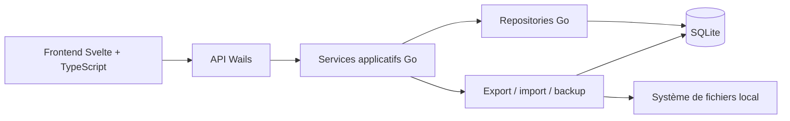

# Architecture de NoteCore V1

## 1. Positionnement

NoteCore V1 est une application de bureau locale, offline-first et mono-utilisateur. Elle est conçue comme un monolithe modulaire : un seul processus applicatif, avec une frontière claire entre l'interface, les cas d'usage et la persistance.

Cette architecture vise d'abord la fiabilité des données, la simplicité d'exploitation et la capacité d'évolution. La V1 ne comporte ni serveur distant, ni compte utilisateur, ni synchronisation réseau.

## 2. Architecture cible



### Frontend

Le frontend Svelte est responsable de l'affichage, de l'état de navigation et des interactions. Il ne connaît ni SQL ni les chemins système. Il appelle uniquement les méthodes Wails exposées par la couche backend.

Organisation recommandée :

```text
frontend/
  src/
    app.css         Jetons de design (couleurs, rayons, ombres, thèmes)
    constants.ts    Constantes partagées de l'interface
    lib/
      api/          Contrats et appels Wails
      components/   Composants d'interface réutilisables
      stores/       État de session et préférences d'affichage
      editor/       Éditeur Markdown (moteur de rendu) et aperçu
      utils/        Formatage, extraits de recherche, teintes d'étiquettes
    routes/         Vues principales
```

**Direction visuelle.** L'identité « encre et papier » suit une référence de design externe : des neutres purs, du plus sombre au plus clair (contenu, liste, barre latérale — la barre latérale est la plus claire), un accent indigo d'encrier et quatre pastels de surligneur (bleu, vert, jaune, violet) employés comme couleurs d'étiquettes. Tous les jetons vivent dans `src/app.css` (`:root`, puis `[data-theme='light'|'dark']`) ; aucun composant n'invente une couleur. Chaque étiquette reçoit une teinte stable par hachage de son nom (`lib/utils/tags.ts`), sans stockage. Les contrastes texte/fond des deux thèmes sont tenus au-dessus de 4,5:1.

**Interactions clavier** (cahier des charges §3.6). Les raccourcis globaux — `Ctrl/Cmd+N` (nouvelle note), `Ctrl/Cmd+K` (rechercher), `Ctrl/Cmd+S` (enregistrer) — sont câblés dans `routes/Workbench.svelte` ; seules les combinaisons avec modificateur sont interceptées, la frappe libre reste intacte. Ils sont neutralisés tant qu'une boîte modale est ouverte (`[aria-modal='true']`). Dans l'éditeur, `Ctrl/Cmd+B` et `Ctrl/Cmd+I` appliquent gras et italique au texte sélectionné.

**Éditeur Markdown** (cahier des charges §3.4). Le contenu reste du Markdown pur — aucune mise en forme propriétaire n'est stockée, ce qui préserve la portabilité (§6.5). Une barre de commandes essentielles agit sur la sélection ou la ligne courante : titres, gras, italique, mise en évidence, code (en ligne et en bloc), listes (puces, ordonnée, cases à cocher), citation, lien, image (depuis une URL), pièces jointes locales (`Joindre`), séparateur, effacement de la mise en forme. Le rendu d'aperçu (`lib/editor/markdown.ts`) échappe toute entrée puis ne pose que les balises qu'il connaît : aucun HTML inline, et seuls `http(s)`/`mailto` (liens) et `http(s)` (images distantes) sont acceptés — `javascript:`, `data:` et `file:` sont refusés (§6.4). Une référence `attachment:<id>` n'est acceptée que sous la forme d'un identifiant strictement borné ; ses octets sont ensuite lus dans SQLite par l'aperçu, jamais depuis le réseau.

**Préférences d'affichage** (cahier des charges §3.6). Police (serif/sans/mono), taille du texte et largeur de colonne sont réglables depuis la barre latérale. Ces choix sont **locaux et sans effet sur la note** : ils s'appliquent par variables CSS (`--editor-font`, `--editor-font-size`, `--editor-width`) et sont conservés dans la table `settings` (`lib/stores/display.ts`).

**Accessibilité** (cahier des charges §8.11). Aucun contrôle interactif n'est imbriqué dans un autre : dans la liste, le bouton de sélection et le bouton d'épinglage sont frères. Les boîtes de confirmation (`ConfirmDialog.svelte`) déplacent le focus à l'ouverture, le piègent sur Tab/Maj+Tab, se ferment sur Échap et restituent le focus à la fermeture. Les changements d'état non sollicités — état de sauvegarde, notifications, états vides — passent par des régions `aria-live`/`role='status'`.

**Recherche** (cahier des charges §3.3). Le backend renvoie un extrait déjà construit (`snippet` FTS5, termes encadrés de « »). Le store conserve ces extraits (`Map` id → hit) et la liste les affiche à la place de l'extrait brut, les termes trouvés étant surlignés (`snippetParts` dans `lib/utils/format.ts`).

### Backend Go

Le backend est un monolithe modulaire organisé par responsabilité :

```text
backend/
  internal/
    app/             Cas d'usage et transactions applicatives
    notes/           Notes, dossiers, tags, pièces jointes et règles métier
    search/          Recherche et construction des extraits
    storage/         Connexion SQLite, schéma et migrations
    transfer/        Export, backup, validation et restauration
    preferences/     Paramètres locaux
  bindings/          Méthodes exposées à Wails
```

Les bindings Wails restent minces : ils valident les entrées de transport, appellent un service applicatif et convertissent les erreurs en résultats compréhensibles par l'interface.

## 3. Choix de stockage

Le contenu Markdown et les métadonnées sont conservés dans SQLite. SQLite est l'unique source de vérité pour les notes ; les fichiers Markdown sont des sorties d'export, pas une seconde copie active.

Ce choix réduit les scénarios de divergence lors de l'autosauvegarde, du déplacement d'une note, de la suppression d'un dossier et de la restauration. Les écritures sont effectuées dans des transactions SQLite courtes.

Le fichier de base est placé dans le répertoire de données utilisateur de la plateforme, jamais dans le répertoire d'installation. Le chemin exact est fourni par Wails/Go selon le système d'exploitation.

## 4. Modèle de données recommandé

```sql
notes(id, title, content, folder_id, is_pinned, created_at, updated_at)
folders(id, name, created_at, updated_at)
tags(id, name)
note_tags(note_id, tag_id)
settings(key, value)
attachments(id, note_id, filename, mime, size, data, created_at)
```

Contraintes principales :

- identifiants générés par l'application et stables lors des exports ;
- `folder_id` nullable avec `ON DELETE SET NULL` ;
- unicité insensible à la casse sur le nom d'un dossier dans son espace ;
- unicité insensible à la casse sur le nom d'un tag ;
- clé primaire composite sur `note_tags` ;
- `attachments.note_id` avec `ON DELETE CASCADE` : une pièce jointe appartient à une seule note et la suit dans sa suppression ;
- index sur `notes(updated_at)`, `notes(folder_id)`, `notes(is_pinned)` et `attachments(note_id)` ;
- dates stockées dans un format UTC normalisé ;
- migrations versionnées et exécutées au démarrage avant l'ouverture fonctionnelle de l'application.

La recherche utilise SQLite FTS5 sur le titre, le contenu et les tags. La table FTS est maintenue par le backend dans la même transaction que la note, afin d'éviter un index de recherche obsolète.

**Préférences** (cahier des charges §3.6). La table `settings(key, value)` est la source de vérité des préférences d'affichage ; elle est lue et écrite par le paquet `internal/preferences`, exposé par `GetSettings`/`SetSetting`. Les réglages sont bornés (clé ≤ 64, valeur ≤ 512 caractères). Au démarrage, l'interface hydrate son état en un seul appel (`GetSettings`) ; chaque changement est écrit côté backend. Le stockage du navigateur n'est qu'une amorce locale, destinée à éviter un premier rendu dans le mauvais thème : en cas de divergence, la table `settings` gagne. À la première exécution après la bascule, la valeur d'amorce y est recopiée, si bien qu'aucun choix existant n'est perdu.

**Pièces jointes** (cahier des charges §10, ADR-006). Une image ou un fichier local peut être joint à une note. Les octets vivent dans la table `attachments` — **une seule copie, dans la base SQLite locale, sans service externe ni réseau** — ce qui fait des pièces jointes un contenu comme un autre : sauvegardé, restauré et supprimé avec la note (§5.3, §6.2). La charge arrive en base64 depuis l'interface (le pont Wails ne transporte pas de binaire) ; le backend borne la taille (10 Mio par pièce jointe), normalise le type et assainit le nom, qui ne sert jamais à construire un chemin. Dans le Markdown, la référence est `` pour une image et `[nom](attachment:<id>)` pour un fichier ; seule l'interface sait les interpréter, et l'export les réécrit en chemins relatifs pour rester lisible sans NoteCore (§3.7). Les bindings exposés sont `AddAttachment`, `ListAttachments`, `ReadAttachment`, `DeleteAttachment` et `SaveAttachment` (dernier : enregistrement d'un fichier non-image via le dialog système).

## 5. Autosauvegarde

Le frontend conserve les modifications en mémoire pendant la saisie et déclenche une commande de sauvegarde après une courte période d'inactivité. Le backend refuse les mises à jour obsolètes grâce à un numéro de version ou à la date connue par le client.

États exposés à l'interface : `saved`, `dirty`, `saving` et `error`. Une fermeture normale demande une dernière sauvegarde lorsque l'état est `dirty`; une erreur est affichée et empêche de présenter la note comme enregistrée.

## 6. Export, backup et restauration

- Export individuel : génération d'un fichier Markdown UTF-8 depuis SQLite, avec les pièces jointes écrites dans un dossier frère `<titre>-assets/` et les références `attachment:<id>` réécrites en chemins relatifs.
- Export multiple : archive versionnée contenant les notes Markdown, leurs pièces jointes et un manifeste JSON.
- Backup complet : copie cohérente de la base après checkpoint SQLite, avec métadonnées de format et version de schéma. Les pièces jointes y sont incluses naturellement : elles vivent dans la base.
- Restauration : lecture dans une zone temporaire, validation du manifeste et du schéma, aperçu du conflit, puis remplacement atomique ou import explicite. Une sauvegarde de schéma antérieur (sans table `attachments`) reste restaurable : la table absente est simplement ignorée.

La validation d'une sauvegarde est un contrat strict, refusant par défaut :

- le manifeste doit être présent et bien formé ; le format, la version de conteneur et la version de schéma sont connus (`transfer` refuse une version plus récente que celle de l'application) ;
- l'empreinte SHA-256 et la taille sont obligatoires et doivent correspondre exactement au contenu : une archive sans empreinte, tronquée ou altérée est rejetée avant toute écriture ;
- la base est bornée en taille avant extraction (défense contre les archives hostiles) et la taille écrite est revérifiée ; les tables attendues sont contrôlées après extraction ;
- les fichiers de sauvegarde et temporaires sont créés avec des permissions restreintes (`0600`), et le renommage final est synchronisé sur le disque.

Une restauration ne remplace jamais silencieusement les données courantes. Les opérations de remplacement utilisent un fichier temporaire puis un renommage atomique lorsque la plateforme le permet.

## 7. Sécurité et confidentialité

- aucune requête réseau pour les fonctions V1 ;
- requêtes SQLite paramétrées ;
- validation de la taille et du format des imports ;
- aperçu Markdown rendu avec une politique qui désactive les scripts et les URLs dangereuses ;
- chemins d'export contrôlés par les sélecteurs système et non construits directement à partir d'une entrée utilisateur ;
- erreurs techniques journalisées sans inclure le contenu complet des notes ;
- permissions du fichier de données limitées au compte utilisateur lorsque le système le permet.

## 8. Limites et évolutivité

Cette architecture est adaptée à une base locale de plusieurs milliers de notes et à un utilisateur par installation. Elle ne fournit pas de synchronisation multi-appareils ni de collaboration. Ces fonctions nécessiteraient ultérieurement un service distant, une stratégie de résolution de conflits et une identité utilisateur ; elles ne doivent pas être simulées dans la V1.

## 9. Validation technique initiale

Avant l'implémentation fonctionnelle, le projet doit valider :

1. l'initialisation Wails et le lancement Svelte sur les plateformes retenues ;
2. l'ouverture SQLite dans le répertoire utilisateur ;
3. l'exécution idempotente des migrations ;
4. l'indexation FTS5 avec accents et blocs de code ;
5. le backup et la restauration après interruption pendant une écriture.
